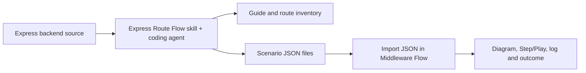

# Express Route Flow

Analyze an Express backend's routes, controllers and middleware, then generate step-by-step request-flow walkthroughs and importable visualization scenarios.

**Express Route Flow is an AI coding-agent skill. Its companion, [SMSM Middleware Flow](https://middleware-flow-visualizer.vercel.app/), is the interactive simulator that displays the generated scenarios.**

[Open Middleware Flow](https://middleware-flow-visualizer.vercel.app/) · [Middleware Flow source and setup](https://github.com/ahmedsamy13/middleware-flow-visualizer-) · [Skill instructions](SKILL.md)

## Why use them together?

An endpoint often crosses several files before it sends a response: application middleware, mounted routers, authentication, role checks, validation, a controller and sometimes an error handler. Reading only the controller can hide an earlier response, a skipped handler or an unexpected mount path.

This skill follows those registrations from source and records the evidence. The simulator makes the selected flow visible, one event at a time.

Together they help you:

- Learn how an unfamiliar Express project handles a request.
- Explain routes to teammates without repeatedly walking through every source file.
- Understand middleware order, nested router paths and error propagation.
- Compare a successful request with an authentication or validation failure.
- Identify routes or branches that are unresolved or cannot be represented faithfully.
- Prepare a checklist for subsequent real API testing.

They complement source review and API tests. A successful simulation does not prove that a database query, JWT check or live endpoint works.

## What each project does

| Project | Input | Output |
| --- | --- | --- |
| **Express Route Flow** | An Express backend's source, read by your coding agent | A route inventory, coverage notes, a human-readable guide and scenario JSON files |
| **SMSM Middleware Flow** | An imported scenario JSON file | A diagram, execution log, request snapshots and simulated response/outcome |

The connection is **JSON file import**. The skill does not upload your code to the simulator, call its API or automatically trace a running Express application. The simulator processes imported configurations in your browser without uploading or persisting them. Your coding agent's own source-access and data policies still apply during analysis.



## Requirements

- A coding agent that can read local project files and follow a `SKILL.md` workflow, such as Codex, Claude Code or Gemini CLI.
- Access to your **Express backend** folder, including routes/controllers and their relevant helpers. A React frontend folder alone is insufficient.
- Node.js **22.18+** for the bundled helper scripts.
- A trusted TypeScript compiler installation for optional AST discovery. You can use the backend's existing compiler or the simulator's `node_modules/typescript`. If absent, the agent can use manual source review instead.
- A local clone of Middleware Flow for engine-based scenario validation. Using the hosted simulator for import/playback does not require running it locally.

This repository contains the skill, helper scripts and documentation. It does not include the visualizer application or a backend server. There is no `npm start` for this skill.

## Install the skill

The skill identifier is **`express-route-flow`**. Copy the **whole folder**, including `scripts/` and `references/`, rather than copying only `SKILL.md`.

### Codex

For a project-scoped installation, clone the skill into your backend's `.agents/skills` directory. Replace the example backend path with yours:

```powershell
Set-Location "D:\Your Backend"
New-Item -ItemType Directory -Force -Path ".agents/skills" | Out-Null
git clone https://github.com/ahmedsamy13/Express-Route-Flow.git .agents/skills/express-route-flow
```

Open that backend in Codex and start a chat. Invoke the skill with `$express-route-flow`. If it does not appear, restart Codex. You can also ask `$skill-installer` to install this repository as a personal skill.

### Claude Code

From your backend folder:

```powershell
New-Item -ItemType Directory -Force -Path ".claude/skills" | Out-Null
git clone https://github.com/ahmedsamy13/Express-Route-Flow.git .claude/skills/express-route-flow
```

Start Claude Code in that backend and invoke:

```text
/express-route-flow Analyze this backend and generate Middleware Flow walkthroughs.
```

### Gemini CLI

Install from the repository:

```powershell
gemini skills install https://github.com/ahmedsamy13/Express-Route-Flow.git
```

Then open Gemini CLI in your backend, use `/skills reload` and `/skills list`, and ask:

```text
Use the express-route-flow skill to analyze this backend and generate Middleware Flow walkthroughs.
```

The file format is supported by these hosts. This package's helpers have been tested locally with the companion engine; complete Claude Code and Gemini CLI agent runs have not been verified. Tool access, permissions and generated-document quality depend on the host. Postman skill integrations are optional, and `agents/openai.yaml` provides Codex-specific presentation metadata.

Installation documentation: [Codex](https://learn.chatgpt.com/docs/build-skills), [Claude Code](https://code.claude.com/docs/en/skills), [Gemini CLI](https://geminicli.com/docs/cli/skills/).

## Use both projects: step by step

### 1. Open your Express backend in the coding agent

Use the folder containing `package.json`, the app/bootstrap, routers and controllers. Do not point the skill at this repository or the visualizer's React source when you want it to analyze your backend.

### 2. Ask the agent to analyze it

For Codex, paste this into the **chat**, not a terminal:

```text
$express-route-flow

Analyze my Express backend at D:\Your Backend.
The Middleware Flow source is at D:\Middleware Flow.

Inspect every route, router, controller and middleware registration order.
Create a beginner-friendly English guide for every concrete route/method,
with separate success and source-supported error scenarios.
Generate importable SMSM Middleware Flow JSON configurations.
Validate them against the local simulator engine.
Report unsupported or unresolved behavior and include source-file evidence.
Save the results in docs/middleware-flow/.
```

Replace both example paths with actual paths. You can request another guide language. For other agents, use their invocation described above with the same task details.

### 3. Read the generated guide and coverage report

Expected backend output:

```text
docs/middleware-flow/
├── GUIDE.md
├── route-inventory.json
├── coverage.json
├── scenario-manifest.json
├── scenarios/
│   ├── tours-get-one-success.json
│   ├── tours-get-one-not-found.json
│   └── users-update-forbidden.json
└── validation.json
```

Filenames and scenario counts depend on your source. These names are examples, not files bundled with this repository. `discovery.json` may also be generated for navigation. `validation.json` is produced when the local engine check actually runs; otherwise the guide must label scenarios unverified.

| Artifact | How to use it |
| --- | --- |
| `GUIDE.md` | Follow the route index and numbered scenario instructions |
| `route-inventory.json` | Review methods, full/local paths, mounts, handler chains and evidence |
| `coverage.json` | Find modeled, partial, unsupported and unresolved routes/branches |
| `scenario-manifest.json` | Read selected inputs, assumptions and expected traces; use for validation |
| `scenarios/*.json` | **Import these files into Middleware Flow** |
| `validation.json` | Inspect engine-check results; this is not a live API test report |

**Import a scenario, not the guide, inventory or manifest.** Every concrete route/method should have a walkthrough or an explicit explanation of why it cannot be modeled. Dynamic or missing source cannot be silently treated as covered.

### 4. Open Middleware Flow

Use the [hosted simulator](https://middleware-flow-visualizer.vercel.app/), or run its separate repository locally:

```powershell
git clone https://github.com/ahmedsamy13/middleware-flow-visualizer-.git "D:\Middleware Flow"
Set-Location "D:\Middleware Flow"
npm install
npm run dev -- --port 5176
```

Open `http://127.0.0.1:5176/`. If you already have a local checkout, reuse it; no second clone is needed. Installing its dependencies also makes its TypeScript compiler available to the skill's scanner.

### 5. Import one scenario

1. Click **Import JSON** in Middleware Flow.
2. Select the matching file from your backend's `docs/middleware-flow/scenarios/` folder.
3. Check the displayed request method and URL against `GUIDE.md`.
4. Click **Reset execution**.

A scenario contains an explicitly configured stack and selected branch. It may retain several routes to preserve registration order; the view controls decide which ones appear.

### 6. Choose how much to see

| Control | What it shows |
| --- | --- |
| **Request path only** | Only entered routers/routes and executed handlers. Unrelated/skipped layers are hidden from both diagram and log |
| **Full stack** | Every configured registration, including skipped steps and reasons |
| **Reveal as you step** | In request-only view, draws visited nodes progressively instead of showing the complete selected path upfront |

The stack editor retains the full configuration. Filtering does not delete registrations, change the simulated result or remove layers from JSON exports/generated code. Use **Full stack** when the guide asks you to inspect why another route or handler was skipped.

### 7. Follow the request

1. Press **Step** and read the new execution-log entry.
2. Identify the active handler in the diagram.
3. Inspect the request snapshot: local path, `baseUrl`, params and configured custom properties.
4. Continue until the response/final outcome. Request-only playback skips omitted events rather than waiting through them.
5. Compare the status and selected response with the guide's expectations.

Successful responses show **Completed** with their HTTP status. Error responses show **Failed**, unmatched requests show **Not found**, and a handler doing nothing shows **Pending**. Pending means no response was sent. **Play** runs automatically, **Pause** stops playback, and **Reset execution** starts over.

### 8. Compare another branch

Import the linked error/alternative scenario and repeat. An authenticated success and an authentication failure are separate configured branches. Typing a token, body or query into documentation does not make the simulator evaluate the real authentication/controller code.

## Example: a tour endpoint

Given an illustrative registration such as:

```js
app.use('/api/v1/tours', tourRouter);
tourRouter.get('/:id', protect, getTour);
app.use(globalErrorHandler);
```

A source-backed success scenario might show:

```text
GET /api/v1/tours/demo-tour
→ enter tours router
→ match GET /:id
→ protect: chosen authenticated branch calls next()
→ getTour: chosen success branch sends a response
→ Completed · HTTP 200
```

A source-backed authentication failure might instead show `protect` forwarding an error and an eligible error handler returning 401. The skill must inspect the actual implementations before choosing those statuses or actions; middleware names alone are not evidence.

## How the skill works

1. **Discover:** optional TypeScript AST scanning finds route-shaped calls, imports, source locations and syntax issues. It never executes your backend.
2. **Trace:** the coding agent resolves Express receivers, mounts, registration helpers, controllers and relevant services from source. Scanner candidates are not automatically confirmed routes.
3. **Document:** record observed requirements, handler order, outcomes, source evidence, assumptions and coverage gaps.
4. **Model:** create a fixed-action scenario for each meaningful supported branch while preserving relevant registration order.
5. **Validate:** the helper calls the trusted simulator's `validateConfig` and `simulate`, then checks expected outcomes, status, ordered handler runs, skips and snapshots.

## Helper scripts

Replace paths with your installations. These helpers support the agent workflow; running the scanner alone does not generate a complete guide.

```powershell
# AST discovery candidates
node "<skill>/scripts/scan-express.mjs" --app "D:/Your Backend" --out "D:/Your Backend/docs/middleware-flow/discovery.json" --typescript "D:/Middleware Flow/node_modules/typescript"

# Validate generated scenarios against the companion engine
node --experimental-strip-types "<skill>/scripts/validate-scenarios.mjs" --simulator "D:/Middleware Flow" --manifest "D:/Your Backend/docs/middleware-flow/scenario-manifest.json" --out "D:/Your Backend/docs/middleware-flow/validation.json"

# Check the bundled helpers using synthetic fixtures
node "<skill>/scripts/self-test.mjs" --simulator "D:/Middleware Flow" --typescript "D:/Middleware Flow/node_modules/typescript"
```

The self-test checks AST discovery, 12 explicitly asserted simulator scenarios and five negative validation cases. It never starts the fixture backend or tests your real API. See [analysis and delivery](references/analysis-and-delivery.md) and [configuration/manifest format](references/simulator-format.md).

## Important limits

- The simulator targets **Express 5**. Express 4 promise wrappers/version differences need explicit review.
- Supported routing is literal segments and named `:params`. Regex/wildcards/optional syntax, `router.param` preprocessing, `mergeParams:true` and other advanced behavior need documented limitations.
- Headers, bodies, JWT checks, database queries and conditional branches are not executed. Each scenario selects a fixed action per handler.
- No automatic real-app tracing, arbitrary pasted JavaScript, callback scheduling, streaming or code-after-`next()` execution. `next()` transfers control but does not terminate a JavaScript function.
- Large stacks may exceed import limits. The guide must disclose slices/omissions and cannot claim whole-app coverage if omitted registrations could change the result.
- Use synthetic inputs in generated artifacts; do not copy real credentials, tokens, personal records or password hashes.

For real endpoint behavior, run the application with appropriate test data and use API/integration tests or Postman separately.

## Repository contents

```text
SKILL.md                         Agent workflow and activation description
agents/openai.yaml               Codex display name and invocation metadata
references/analysis-and-delivery.md
references/simulator-format.md   Companion configuration and manifest contract
scripts/scan-express.mjs          Static AST candidate discovery
scripts/validate-scenarios.mjs    Engine-based scenario assertions
scripts/self-test.mjs             Synthetic helper checks
README.md                        Installation and joint-use guide
```

The separate [Middleware Flow repository](https://github.com/ahmedsamy13/middleware-flow-visualizer-) contains the React application, Express 5 simulation engine and its tests. This repository stays focused on the reusable analysis skill.
